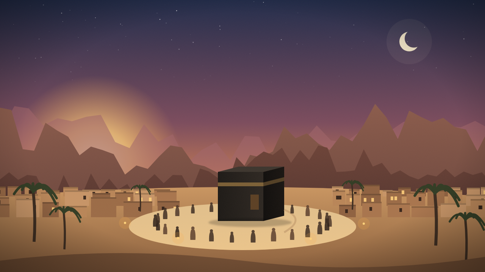

# सय्यिदा फ़ातिमा बिन्त मुहम्मद ﷺ: इज़्ज़त का असल मेयार

*यह तहरीर उमर सुलेमान के बयान "Role Model for Modesty: Fatima bint Muhammad – Women of Paradise" से माख़ूज़ है ([YouTube पर देखिए](https://www.youtube.com/watch?v=oXi0xqfiBfk))*

---

## हरम-ए-काबा का एक वाक़िया

दावत-ए-इस्लामी का इब्तिदाई ज़माना था। मक्का की पूरी जाहिली सोसाइटी उस एक आवाज़ को दबाने पर तुली हुई थी जो अल्लाह की बंदगी की तरफ़ बुला रही थी। एक रोज़ नबी-ए-करीम सल्लल्लाहु अलैहि वसल्लम हरम-ए-काबा में नमाज़ अदा फ़रमा रहे थे। क़रीब ही क़ुरैश के चंद सरदार बैठे थे जिनका लीडर अबू जहल था, वही शख़्स जो इससे पहले आप पर ख़ाक फेंक चुका था और हालत-ए-नमाज़ में आप की गर्दन-ए-मुबारक पर पाँव रखने की हिम्मत कर चुका था। उस दिन उन लोगों ने बेइज़्ज़ती का एक और तरीक़ा सोचा। उनमें से एक बदनसीब उठा, ज़बह शुदा ऊँट की ओझड़ी और गंदगी उठा लाया, और जब आप सजदे में गए तो यह सब आप की पुश्त-ए-मुबारक पर डाल दिया। बोझ ऐसा था कि आप सर न उठा सके, और वो सरदार हँसते हँसते एक दूसरे पर गिरे जाते थे।

उस वक़्त एक कमसिन बच्ची दौड़ती हुई आई। यह आप की साहिबज़ादी फ़ातिमा रज़ियल्लाहु अन्हा थीं, जिनकी उम्र अभी जवानी को भी न पहुँची थी। उन्होंने न उन सरदारों के रोब की परवा की, न उनकी ज़ोर की हँसी की। अपने नन्हे हाथों से बाप की पुश्त से वो गंदगी हटाई, और फिर बर्दाश्त का बंधन टूट गया और रो पड़ीं। नबी सल्लल्लाहु अलैहि वसल्लम ने फ़रमाया: "बेटी, रो नहीं। अल्लाह तुम्हारे बाप की हिफ़ाज़त करेगा और उसे जीत अता फ़रमाएगा।" फिर आप ने उन लोगों के हक़ में बद्दुआ फ़रमाई, और तारीख़ गवाह है कि बद्र के मैदान में यही लोग सबसे पहले हलाक होने वालों में थे।

इस वाक़िए पर ग़ौर कीजिए। आम इंसानी तजुर्बा यह है कि ऐसा सदमा एक बच्चे के दिल में उस मक़सद के ख़िलाफ़ तल्ख़ी बिठा देता है जिसकी ख़ातिर उसे यह दुख उठाना पड़ा हो। वो सोच सकती थीं कि अगर मेरे वालिद यह दावत न देते तो हम पर यह मुसीबत न आती। मगर यहाँ मामला उल्टा हुआ। इस आज़माइश ने फ़ातिमा के दिल में अपने वालिद के मिशन की मोहब्बत को और गहरा कर दिया। यही वो फ़र्क़ है जो ईमान पैदा करता है: मोमिन के लिए मुसीबत शिकवे का नहीं, डटे रहने का सबब बनती है।

---

## फ़ातिमा ही क्यों?

यहाँ फ़ितरी तौर पर यह सवाल पैदा होता है कि नबी सल्लल्लाहु अलैहि वसल्लम की दूसरी साहिबज़ादियाँ भी थीं, फिर यह ख़ास मक़ाम फ़ातिमा ही को क्यों हासिल हुआ कि वो उन चंद ख़वातीन में शुमार हुईं जिन्होंने ईमान का कमाल पाया? अहल-ए-इल्म ने इसके चंद वजहें बयान किए हैं, और उनमें से हर एक अपने अंदर एक गहरा सबक़ रखता है।

पहला सबब यह है कि उन्हें अपनी वालिदा उम्मुल मोमिनीन ख़दीजा रज़ियल्लाहु अन्हा की सोहबत सबसे ज़्यादा हासिल हुई। ख़दीजा ख़ुद उन ख़वातीन में से थीं जिनके ईमान को कामिल क़रार दिया गया। फ़ातिमा ने उनके अख़लाक़ और उनके तौर तरीक़े इस तरह अपने अंदर जज़्ब किए कि वो उनकी सीरत का हिस्सा बन गए। इससे यह हक़ीक़त वाज़ेह होती है कि इंसान की सीरत ख़ाली जगह में नहीं बनती; जिस माहौल में वो पलता है और जिन शख़्सियतों को वो क़रीब से देखता है, उन्हीं का झलक उसके किरदार में उतरता है।

दूसरा सबब यह है कि वो उन दिनों में अपने वालिद के साथ रहीं जब कोई और साथ न था। वही उतरने के वक़्त उनकी उम्र कम-ओ-बेश पाँच बरस थी, गोया उन्होंने आँख ही इस्लाम के घराने में खोली और उसी फ़िज़ा में परवान चढ़ीं। फिर जब ख़दीजा का इंतक़ाल हुआ तो घर में सिर्फ़ नबी सल्लल्लाहु अलैहि वसल्लम और यह कमसिन बेटी रह गईं। ज़रा तसव्वुर कीजिए उन शामों का जब आप दिन भर की मुख़ालफ़त और तन्हाई का बोझ लिए घर लौटते होंगे। उस वक़्त यही बेटी आप के लिए खाना तैयार करती, आप का दिल रखती और माँ की ख़ाली जगह को अपनी ख़िदमत से पूरा करती थी। इसी बिना पर लोग उन्हें "उम्म-ए-अबीहा" यानी अपने बाप की माँ कहने लगे। इंसानी अज़मत का आग़ाज़ अक्सर उन्हीं गुमनाम ख़िदमात से होता है जिन्हें दुनिया की आँख नहीं देखती मगर अल्लाह की निगाह से छुपी नहीं रहतीं।

तीसरा सबब यह है कि वो सीरत-ओ-सूरत में अपने वालिद का अक्स थीं। उनका लक़ब "ज़हरा" इसी लिए पड़ा कि उनका चेहरा रौशन और चमकदार था, जिस तरह नबी सल्लल्लाहु अलैहि वसल्लम के चेहरा-ए-मुबारक को चौदहवीं के चाँद की मिसाल दी गई है। उम्मुल मोमिनीन आयशा रज़ियल्लाहु अन्हा की गवाही है कि उन्होंने गुफ़्तगू, अंदाज़ और तौर तरीक़ों में रसूलुल्लाह सल्लल्लाहु अलैहि वसल्लम से फ़ातिमा से बढ़ कर मिलता जुलता किसी को नहीं देखा। जब वो आप के पास आतीं तो आप खड़े हो जाते, उनका इस्तिक़बाल फ़रमाते, उनकी पेशानी चूमते, उनका हाथ पकड़ कर अपनी जगह पर बिठाते। यह उस मुआशरे में एक बेटी की इज़्ज़त थी जहाँ बेटियों को ज़िंदा दफ़न कर देना शर्म की बात नहीं समझा जाता था।

---

## इज़्ज़त का जाहिली तसव्वुर और इस्लामी तसव्वुर

नबी सल्लल्लाहु अलैहि वसल्लम ने फ़ातिमा को जन्नत की औरतों की सरदार क़रार दिया। अब ज़रा सोचिए कि दुनिया का आम तसव्वुर ऐसी शहज़ादी के बारे में क्या होता? यही कि उसका बाप उसकी शादी किसी बड़े दौलतमंद से करता, उसे महल में रखता और हर आसाइश उसके क़दमों में डाल देता। मगर यहाँ देखिए कि क्या हुआ। कई मालदार और साहिब-ए-हैसियत सहाबा की तरफ़ से पैग़ाम आए और आप ने उन्हें क़ुबूल न फ़रमाया। आप की पसंद अली बिन अबी तालिब रज़ियल्लाहु अन्हु ठहरे, जिन्हें हिजरत के बाद आप ने अपना भाई बनाया था और जिनके पास दुनिया के माल में से कुछ न था।

अली जब पैग़ाम ले कर हाज़िर हुए तो हया और झिझक के मारे ज़बान से कुछ न कह सके। आप ने ख़ुद ही बात छेड़ी: "शायद फ़ातिमा के लिए आए हो?" अर्ज़ किया: जी हाँ। पूछा: "मेहर में देने को क्या है?" उनके पास एक ज़िरह (लोहे का जंगी लिबास) के सिवा कुछ न था। फ़रमाया: "इसी को बेच दो और इसे मेहर बना दो।" चुनाँचे जन्नत की औरतों की सरदार का निकाह एक ज़िरह की क़ीमत पर हुआ।

यह महज़ एक वाक़िया नहीं बल्कि एक पूरे क़द्रों का निज़ाम का ऐलान है। जाहिलियत इंसान की क़द्र उसके माल, उसकी शान-ओ-शौकत और उस पर ख़र्च होने वाली दौलत से नापती है। इस्लाम ने यह पैमाना तोड़ दिया और बताया कि निकाह की इज़्ज़त उसमें शरीक होने वालों के तक़वा और किरदार से है, तक़रीब की रौनक़ और मेहर की मिक़दार से नहीं।

---

## घर की तामीर में नबवी रहनुमाई

निकाह के बाद भी नबी सल्लल्लाहु अलैहि वसल्लम इस घर से ग़ाफ़िल न हुए। रात को तहज्जुद के लिए दोनों को जगाते, उनके अहवाल दरयाफ़्त फ़रमाते, उनकी ज़रूरतों का ख़याल रखते। यह तवज्जोह इस क़दर थी कि एक बार फ़ातिमा के दिल में यह ख़याल गुज़रा कि शायद आप को अली मुझसे ज़्यादा अज़ीज़ हैं। आप ने, जो ख़ुल्क़-ए-अज़ीम के मालिक थे, दोनों को एक ही मजलिस में यूँ जवाब दिया कि अली से फ़रमाया: "यह मुझे तुमसे ज़्यादा महबूब है", और फ़ातिमा से फ़रमाया: "और यह मेरे नज़दीक तुमसे ज़्यादा अज़ीज़ है।" दोनों के दिल मुतमइन हो गए।

मियाँ बीवी के दरमियान कभी कभार रंजिश का पैदा हो जाना इंसानी फ़ितरत है, और यह घराना भी इससे अलग न था। एक बार किसी बात पर अली नाराज़ हो कर मस्जिद में जा लेटे। नबी सल्लल्लाहु अलैहि वसल्लम उन्हें ढूँढते हुए वहाँ पहुँचे, देखा कि ज़मीन पर लेटे हैं और जिस्म पर मिट्टी लगी है। आप उनके जिस्म से मिट्टी झाड़ते जाते और फ़रमाते जाते: "उठो अबू तुराब!" अली फ़रमाया करते थे कि यह नाम उन्हें सबसे ज़्यादा महबूब था। एक प्यार भरे मज़ाक़ ने तल्ख़ी को दूर कर दिया और दो दिलों को फिर जोड़ दिया। इससे मालूम होता है कि इस्लामी घर वो नहीं जिसमें कभी इख़्तिलाफ़ न हो, बल्कि वो है जिसमें इख़्तिलाफ़ को बर्दाश्त और प्यार से सुलझाया जाए।

---

## ग़रीबी में बेनियाज़ी

अब इस घर की दुनियावी हालत देखिए। जन्नत की औरतों की सरदार के घर में बिछौने के नाम पर सिर्फ़ एक मेंढे की खाल थी। चक्की पीसते पीसते उनके हाथों में छाले पड़ गए थे और पानी ढोते ढोते जिस्म पर निशान आ गए थे। एक जंग के बाद जब कुछ क़ैदी आए तो अली ने मशवरा दिया कि वालिद से एक ख़ादिम माँग लो। नबी सल्लल्लाहु अलैहि वसल्लम उनके घर तशरीफ़ लाए, दोनों के दरमियान बैठ गए और फ़रमाया: "क्या मैं तुम्हें वो चीज़ न बताऊँ जो ख़ादिम से बेहतर है? जब सोने लगो तो तैंतीस बार सुब्हानअल्लाह, तैंतीस बार अल्हम्दुलिल्लाह और चौंतीस बार अल्लाहु अकबर कह लिया करो।"

यह था वो सामान जो दुनिया के सबसे बड़े इंसान ने अपनी सबसे प्यारी बेटी को दिया। जिस्म की राहत नहीं, रूह की क़ुव्वत। और हैरत की बात यह है कि फ़ातिमा के दिल में इस पर कोई शिकायत पैदा न हुई। उन्होंने कभी यह न सोचा कि मैं नबी की बेटी हूँ, इसलिए आराम-ओ-आसाइश मेरा हक़ है। उन्होंने अपने वालिद को मशक़्क़तें झेलते देखा था, ख़ुद उन मशक़्क़तों में शरीक रही थीं, और उसी रास्ते पर चल कर उन्हीं के रंग में रंग गई थीं। थोड़े पर राज़ी रहने की आदत माल की कसरत से पैदा नहीं होती, उस दिल से पैदा होती है जिसका ताल्लुक़ अपने रब से मज़बूत हो।

---

## रुख़सत की घड़ी

जब नबी सल्लल्लाहु अलैहि वसल्लम मर्ज़-ए-वफ़ात में थे तो फ़ातिमा हाज़िर हुईं। वालिद को इस हाल में देख कर रोने लगीं। आप ने उन्हें क़रीब बुला कर कान में कुछ फ़रमाया तो उनका रोना और बढ़ गया। फिर दोबारा क़रीब बुला कर कुछ फ़रमाया तो वो मुस्कुरा दीं। बाद में उन्होंने बताया कि पहली बार आप ने फ़रमाया था कि मैं इस बीमारी से ठीक न हो सकूँगा, और दूसरी बार फ़रमाया कि मेरे घर वालों में सबसे पहले तुम मुझसे आ मिलोगी।

ग़ौर कीजिए, अपनी मौत की ख़बर सुन कर कौन मुस्कुराता है? मगर जिस दिल की असल तमन्ना अल्लाह और उसके रसूल का साथ हो, उसके लिए मौत जुदाई नहीं, मिलाप का पैग़ाम होती है। चुनाँचे आप की वफ़ात के तक़रीबन छह माह बाद, जैसा कि आप ने ख़बर दी थी, वो बीमार हुईं। हक़ीक़त यह है कि वालिद की जुदाई के ग़म ने उन्हें पहले ही निढाल कर रखा था। कमसिन बच्चों की माँ थीं, एक नेक शौहर की बीवी थीं, मगर दिल अपने वालिद के पास पहुँचने को बेताब था।

---

## हया आख़िरी साँस तक

वफ़ात से पहले उन्होंने अस्मा बिन्त उमैस रज़ियल्लाहु अन्हा को बुलाया, जो अबू बक्र सिद्दीक़ रज़ियल्लाहु अन्हु की अहलिया थीं और जिन्होंने उन्हें ग़ुस्ल देना था। उनसे वसीयत की कि मुझे ग़ुस्ल देना और मेरा जनाज़ा उठाना हो तो रात के वक़्त उठाना, ताकि लोगों की निगाह मेरे जिस्म की बनावट पर न पड़े।

यह थी उस ख़ातून की हया जो सबसे बढ़ कर बाहया इंसान सल्लल्लाहु अलैहि वसल्लम की बेटी थीं। ज़िंदगी भर जिस हया को उन्होंने अपना पहचान बनाए रखा, मौत की दहलीज़ पर भी उसी की फ़िक्र थी। चुनाँचे उनकी वसीयत के मुताबिक़ उन्हें रात के वक़्त दफ़न किया गया, और अल्लाह तआला ने उन्हें उनके वालिद-ए-गिरामी सल्लल्लाहु अलैहि वसल्लम से मिला दिया, जहाँ वो जन्नत की औरतों की सरदार के मक़ाम पर हैं।

---

## ख़ुलासा

अब एक लम्हे के लिए यह सवाल अपने आप से कीजिए कि शानदार शादी, भारी मेहर और ऐश-ओ-आराम की ज़िंदगी का फ़ातिमा से बढ़ कर कौन हक़दार था? और फिर देखिए कि इनमें से कोई चीज़ उन्हें न मिली, और इसके बावजूद उनकी अज़मत में ज़र्रा बराबर कमी न आई। इसकी वजह यह है कि जो बादशाही किसी भी लम्हे छिन जाए, वो दरहक़ीक़त बादशाही है ही नहीं। असल क़द्र उस चीज़ की है जो बाक़ी रहने वाली है, और इसी मानी में फ़ातिमा मलिका हैं, जन्नत की मलिका।

आज की मुसलमान औरत के सामने इज़्ज़त और कामयाबी के बहुत से पैमाने रखे जाते हैं: ज़ाहिरी चमक दमक, दौलत की नुमाइश, लोगों की तवज्जोह। सय्यिदा फ़ातिमा की ज़िंदगी इन सब पैमानों को रद्द करती है। वो बताती है कि औरत का असल ख़ूबी हक़ पर डट जाने की हिम्मत में है, उन ख़िदमात में है जो कोई नहीं देखता, थोड़े पर राज़ी रहने वाले दिल में है, घर को नरमी से जोड़े रखने में है, उस हया में है जो आख़िरी साँस तक साथ न छोड़े, और उस ताल्लुक़ में है जो बंदे को उसके रब से जोड़ता है। मुश्किलात ने उन्हें सख़्त दिल नहीं बनाया, बल्कि अपने वालिद सल्लल्लाहु अलैहि वसल्लम की सीरत का आईना बना दिया।

अल्लाह तआला हमारी बहनों और बेटियों को उनके नक़्श-ए-क़दम पर चलने की तौफ़ीक़ दे और जन्नतुल फ़िरदौस में उनका साथ नसीब फ़रमाए। आमीन।
